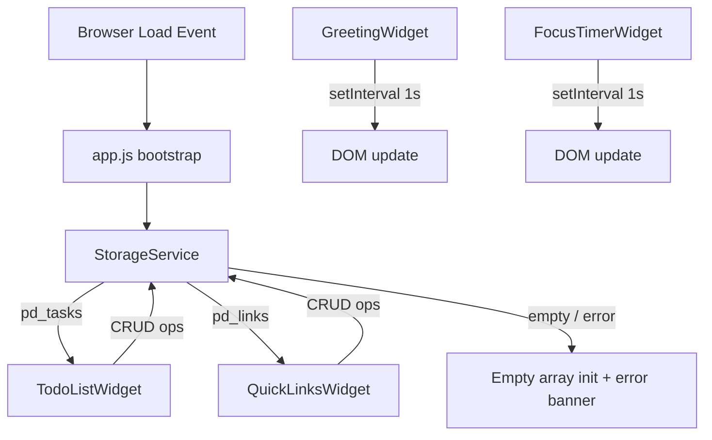

# Design Document: Personal Dashboard

## Overview

A single-page, client-side web application built with plain HTML, CSS, and Vanilla JavaScript. The app runs entirely in the browser with no backend dependencies. All user data (tasks and quick links) is persisted using the browser's `localStorage` API.

The dashboard presents four independent widgets on one page:
- **Greeting Widget** — live clock, date, and time-of-day greeting
- **Focus Timer** — 25-minute Pomodoro-style countdown
- **To-Do List** — persistent task management (add / edit / complete / delete)
- **Quick Links** — persistent shortcut buttons to external URLs

Design goals: minimal DOM operations, zero external dependencies, no build step required, loadable as a static HTML file or a browser extension.

---

## Architecture

The application follows a **module-per-widget** architecture inside a single JavaScript file. Each widget is encapsulated in its own IIFE-style module object with `init()`, `render()`, and event-handler functions. A shared `StorageService` handles all `localStorage` reads and writes.

```
index.html
├── style.css          (all visual styles — one file)
└── app.js             (all application logic — one file)
    ├── StorageService     (read / write / error handling)
    ├── GreetingWidget     (clock, date, greeting)
    ├── FocusTimerWidget   (countdown state machine)
    ├── TodoListWidget     (task CRUD + storage sync)
    └── QuickLinksWidget   (link CRUD + storage sync)
```

### Data Flow



### Key Design Decisions

| Decision | Choice | Rationale |
|---|---|---|
| No framework | Vanilla JS | Zero dependencies, browser-extension compatible, instant load |
| Single JS file | `app.js` | Req 6.5 — no external scripts allowed |
| Single CSS file | `style.css` | Req 6.4 — no inline styles or external sheets |
| Module pattern | Object literals with `init()` | Encapsulation without a build step |
| Storage key strategy | `pd_tasks`, `pd_links` | Namespace collision avoidance per Req 5.1–5.2 |
| Timer state machine | Idle / Running / Paused / Complete | Prevents duplicate intervals, clear state transitions |

---

## Components and Interfaces

### StorageService

Centralises all `localStorage` access to ensure consistent error handling.

```javascript
const StorageService = {
  read(key)          // returns parsed array or null; catches JSON.parse errors
  write(key, array)  // serialises array to JSON; catches write errors
  KEYS: { TASKS: 'pd_tasks', LINKS: 'pd_links' }
}
```

- `read(key)` returns `null` on missing key, and `null` + logs an error on parse failure (corrupt data — Req 5.9).
- `write(key, array)` logs an error and surfaces the failure to the caller if `localStorage.setItem` throws (e.g. quota exceeded).

### GreetingWidget

```javascript
const GreetingWidget = {
  init()         // renders immediately, then starts 1-second interval
  _update()      // reads Date(), updates time/date/greeting DOM nodes
  _getGreeting(hour)  // pure function: hour → greeting string
}
```

- `_getGreeting(hour)` is a pure function mapping hour ranges to greeting strings (Req 1.3–1.6).
- Clock inaccessibility (if `new Date()` throws) is caught; a placeholder is rendered instead (Req 1.8).

### FocusTimerWidget

Implements a four-state machine:

```
IDLE ──[Start]──▶ RUNNING ──[Stop]──▶ PAUSED
  ▲                  │                   │
  └──[Reset]─────────┘    [Start]────────┘
                  │
              [00:00]──▶ COMPLETE ──[Reset]──▶ IDLE
```

```javascript
const FocusTimerWidget = {
  state: 'IDLE',     // 'IDLE' | 'RUNNING' | 'PAUSED' | 'COMPLETE'
  remaining: 1500,   // seconds
  intervalId: null,
  init()
  _tick()            // decrements remaining; transitions to COMPLETE at 0
  _render()          // updates MM:SS display and button enabled/disabled state
  _formatTime(s)     // seconds → "MM:SS" string (pure)
}
```

- A single `setInterval` is stored in `intervalId`; `clearInterval` is called before any new interval is set, preventing duplicate timers (Req 2.7).
- The COMPLETE state applies a CSS class (`.timer--complete`) for the visually distinct state (Req 2.6).

### TodoListWidget

```javascript
const TodoListWidget = {
  tasks: [],   // Task[]
  init()
  _loadFromStorage()
  _save()
  addTask(text)
  toggleComplete(id)
  startEdit(id)
  confirmEdit(id, newText)
  cancelEdit(id)
  deleteTask(id)
  _render()
  _renderTask(task)
}
```

- Each task has a unique `id` generated via `Date.now() + Math.random()` to avoid collisions.
- Edit mode replaces the task's `<li>` content with an `<input>` + confirm/cancel buttons. Pressing `Escape` triggers `cancelEdit` (Req 3.11).
- `_save()` always serialises the full `tasks` array to storage (Req 3.10).

### QuickLinksWidget

```javascript
const QuickLinksWidget = {
  links: [],   // Link[]
  init()
  _loadFromStorage()
  _save()
  addLink(label, url)
  deleteLink(id)
  _validateUrl(url)   // returns true if url starts with http:// or https://
  _render()
  _renderLink(link)
}
```

- `_validateUrl(url)` enforces the `http://` / `https://` prefix requirement (Req 4.3).
- Inline validation messages are inserted adjacent to the invalid field within the same render cycle, satisfying the 100 ms requirement (Req 4.2).
- Link buttons use `target="_blank" rel="noopener noreferrer"` (Req 4.5).

### Bootstrap / App Entry Point

```javascript
document.addEventListener('DOMContentLoaded', () => {
  GreetingWidget.init();
  FocusTimerWidget.init();
  TodoListWidget.init();
  QuickLinksWidget.init();
});
```

All widgets initialise on `DOMContentLoaded`, ensuring content is visible before the browser's `load` event, meeting the 1-second render budget (Req 6.6).

---

## Data Models

### Task

```javascript
{
  id: string,          // unique identifier, e.g. "1729123456789_0.4321"
  text: string,        // 1–500 characters
  completed: boolean   // false = active, true = completed
}
```

Storage key: `pd_tasks` — value is a JSON-serialised `Task[]`.

### Link

```javascript
{
  id: string,    // unique identifier
  label: string, // display label (non-empty)
  url: string    // must start with "http://" or "https://"
}
```

Storage key: `pd_links` — value is a JSON-serialised `Link[]`.

### Timer State (in-memory only, not persisted)

```javascript
{
  state: 'IDLE' | 'RUNNING' | 'PAUSED' | 'COMPLETE',
  remaining: number  // seconds remaining, 0–1500
}
```

### Greeting State (ephemeral, derived each tick)

No stored state. All display values are derived from `new Date()` on each 1-second interval.

---

## Correctness Properties

*A property is a characteristic or behavior that should hold true across all valid executions of a system — essentially, a formal statement about what the system should do. Properties serve as the bridge between human-readable specifications and machine-verifiable correctness guarantees.*

### Property 1: Greeting text coverage

*For any* hour value in [0, 23], `_getGreeting(hour)` SHALL return exactly one of {"Good Morning", "Good Afternoon", "Good Evening", "Good Night"} — the ranges are exhaustive and mutually exclusive.

**Validates: Requirements 1.3, 1.4, 1.5, 1.6**

---

### Property 2: Timer format round-trip

*For any* integer number of seconds `s` in [0, 1500], `_formatTime(s)` SHALL produce a string in "MM:SS" format such that parsing the minutes and seconds back to total seconds returns the original value `s`.

**Validates: Requirements 2.3**

---

### Property 3: Adding a task grows the task list

*For any* non-empty task text of up to 500 characters, calling `addTask(text)` on a TodoListWidget with `n` tasks SHALL result in the widget's task array having length `n + 1`, with the new task at the end having `completed = false`.

**Validates: Requirements 3.1**

---

### Property 4: Whitespace-only task text is rejected

*For any* string composed entirely of whitespace characters, calling `addTask(text)` SHALL leave the task array unchanged.

**Validates: Requirements 3.2**

---

### Property 5: Task completion toggle is an involution

*For any* task, calling `toggleComplete` twice in succession SHALL leave the task's `completed` status unchanged from its initial value (toggle is its own inverse).

**Validates: Requirements 3.4, 3.5**

---

### Property 6: Task persistence round-trip

*For any* sequence of add/edit/delete operations, the task array written to `localStorage['pd_tasks']` via `_save()`, then read back and parsed, SHALL produce an array that is deep-equal to the in-memory `tasks` array at the time of the write.

**Validates: Requirements 3.10, 5.1, 5.7**

---

### Property 7: Quick Links URL validation

*For any* string `url`, `_validateUrl(url)` SHALL return `true` if and only if `url` starts with `"http://"` or `"https://"` (case-sensitive prefix check).

**Validates: Requirements 4.3**

---

### Property 8: Link persistence round-trip

*For any* sequence of add/delete link operations, the links array written to `localStorage['pd_links']` via `_save()`, then read back and parsed, SHALL produce an array deep-equal to the in-memory `links` array at the time of the write.

**Validates: Requirements 4.7, 5.2, 5.8**

---

### Property 9: Storage deserialization produces valid arrays

*For any* value stored under `pd_tasks` or `pd_links`, `StorageService.read(key)` SHALL either return a valid JavaScript array or return `null` — it SHALL never throw an uncaught exception.

**Validates: Requirements 5.9**

---

## Error Handling

| Scenario | Detection | Response |
|---|---|---|
| `localStorage` read fails or data corrupt | `try/catch` around `JSON.parse` in `StorageService.read` | Return `null`; widget initialises with empty array; display error banner (Req 5.6, 5.9) |
| `localStorage` write fails (quota exceeded) | `try/catch` in `StorageService.write` | Log to console; display transient error message to user |
| `new Date()` inaccessible | `try/catch` in `GreetingWidget._update` | Display "Time unavailable" placeholder; no greeting shown (Req 1.8) |
| Widget render exceeds 1-second budget | `setTimeout` watchdog on `DOMContentLoaded` | Show fallback placeholder in widget position; log to console (Req 6.7) |
| Task text > 500 characters | Length check before `addTask` / `confirmEdit` | Reject submission; keep input focused; optionally show character counter |
| URL missing http/https prefix | `_validateUrl` check in `QuickLinksWidget.addLink` | Show inline validation message adjacent to URL field within 100 ms (Req 4.2, 4.3) |
| Empty label or URL on link add | Presence check before `addLink` | Show inline validation message; retain entered values (Req 4.2) |

---

## Testing Strategy

### Unit Tests (example-based)

Focus on concrete scenarios and edge conditions:

- `GreetingWidget._getGreeting`: boundary values (0, 4, 5, 11, 12, 17, 18, 20, 21, 23)
- `FocusTimerWidget._formatTime`: known values (0 → "00:00", 1500 → "25:00", 61 → "01:01")
- `TodoListWidget.addTask`: empty string, whitespace-only string, exactly 500 chars, 501 chars
- `TodoListWidget.confirmEdit`: empty update rejected, edit with valid text accepted
- `QuickLinksWidget._validateUrl`: `http://`, `https://`, `ftp://`, no-scheme strings, empty string
- `StorageService.read`: valid JSON array, malformed JSON, missing key, non-array JSON value
- Timer state transitions: Start → Stop → Start (no duplicate intervals), Reset from each state

### Property-Based Tests

Using a property-based testing library (e.g., [fast-check](https://github.com/dubzzz/fast-check) for JavaScript):

Each test runs a **minimum of 100 iterations** with randomly generated inputs.

| Tag | Property | Generator |
|---|---|---|
| **Feature: personal-dashboard, Property 1: Greeting text coverage** | `_getGreeting(h)` returns valid greeting for all h in [0,23] | `fc.integer({min:0, max:23})` |
| **Feature: personal-dashboard, Property 2: Timer format round-trip** | `_formatTime(s)` parses back to `s` | `fc.integer({min:0, max:1500})` |
| **Feature: personal-dashboard, Property 3: Adding a task grows the task list** | `addTask(text)` increases length by 1 | `fc.string({minLength:1, maxLength:500})` (non-whitespace) |
| **Feature: personal-dashboard, Property 4: Whitespace-only task text is rejected** | `addTask(ws)` leaves array unchanged | `fc.stringOf(fc.constantFrom(' ','\t','\n'))` |
| **Feature: personal-dashboard, Property 5: Task completion toggle is an involution** | double-toggle restores `completed` | `fc.record({id:fc.string(), text:fc.string(), completed:fc.boolean()})` |
| **Feature: personal-dashboard, Property 6: Task persistence round-trip** | `JSON.parse(JSON.stringify(tasks))` deep-equals `tasks` | `fc.array(taskArbitrary)` |
| **Feature: personal-dashboard, Property 7: Quick Links URL validation** | `_validateUrl` iff starts with http/https | `fc.string()` |
| **Feature: personal-dashboard, Property 8: Link persistence round-trip** | `JSON.parse(JSON.stringify(links))` deep-equals `links` | `fc.array(linkArbitrary)` |
| **Feature: personal-dashboard, Property 9: Storage deserialization never throws** | `StorageService.read` returns array or null | `fc.string()` (arbitrary JSON string) |

### Integration / Smoke Tests

- Page loads and all four widgets are visible within 1 second (Req 6.6)
- Data written to `localStorage` survives a page reload and is restored correctly (Req 5.3)
- Link button opens URL in new tab (manual / Playwright E2E test)

### Accessibility

- All interactive controls (buttons, inputs) have visible focus indicators and `aria-label` where text is not descriptive
- Color is not the only indicator for completed tasks (strikethrough text is the primary signal)
- Timer COMPLETE state uses both color change and a visible text indicator (e.g., "Session complete!")
